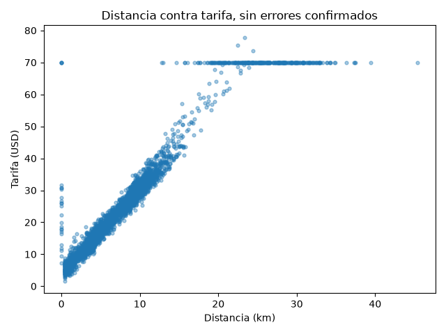
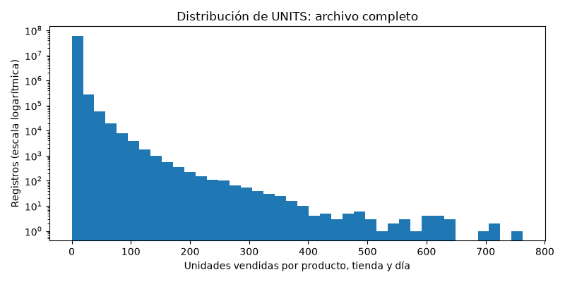
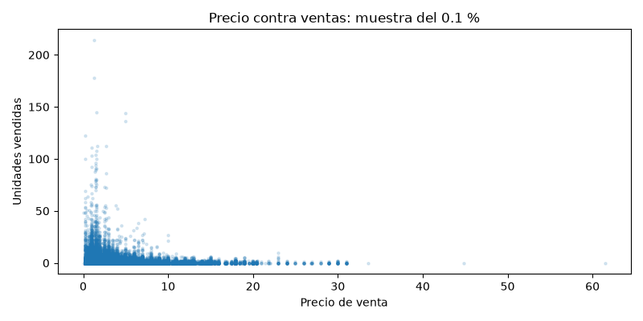
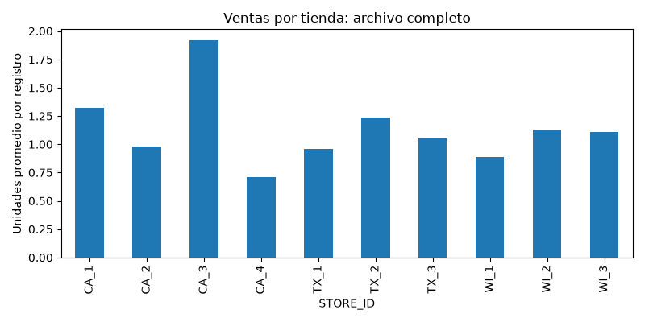

# Semana 8, Sesión 2: Exploración y visualización de datos

> Objetivo de la sesión: explorar el dataset de tu proyecto con estadística descriptiva y visualizaciones para identificar patrones, outliers y supuestos que romperían un modelo antes de entrenarlo.

**Lectura previa de esta sesión:** ["A Data Scientist's Essential Guide to Exploratory Data Analysis"](https://towardsdatascience.com/a-data-scientists-essential-guide-to-exploratory-data-analysis-25637eee0cf6/), Towards Data Science.

**Referencia de esta sesión:** [Machine Learning Zoomcamp, Módulo 1 (DataTalksClub)](https://github.com/DataTalksClub/machine-learning-zoomcamp).

## Requisitos antes de esta sesión

pandas ya lo tienes desde la Semana 4. Instala matplotlib:

```
pip install matplotlib
```

Verifica con:

```
python3 -c "import matplotlib; print(matplotlib.__version__)"
```

Los scripts de hoy guardan cada gráfico como imagen en una carpeta `figuras/`. También puedes correr el mismo código en un notebook de Jupyter, donde el gráfico aparece debajo de la celda.

## Antes de empezar

A partir de la lectura previa:

**Según el artículo, ¿qué preguntas responde la exploración de datos antes de entrenar cualquier modelo?**

La exploración permite responder: qué datos tengo, cuántas observaciones y variables hay y de qué tipo son, cómo se distribuyen los valores, si hay faltantes, duplicados, valores atípicos o categorías desbalanceadas, y qué relaciones o redundancias existen entre las variables y con la variable objetivo. Con esto puedo decidir qué limpieza, transformaciones y selección de variables necesito antes de entrenar el modelo.

**El artículo distingue la exploración de una sola variable de la exploración de la relación entre dos. ¿Qué herramienta propone para cada una?**

Para explorar una sola variable (análisis univariado), el artículo propone estadísticas descriptivas e histogramas si es numérica, o tablas de frecuencias y gráficos de barras si es categórica. Para explorar la relación entre dos variables, propone gráficos de dispersión para observar sus interacciones y coeficientes de correlación, que se pueden presentar en una matriz o un mapa de calor. Además, recomienda `ydata-profiling` para generar estos análisis en un reporte automático.

## Pregunta de apertura

Entrenas un modelo que predice la tarifa de un viaje en taxi. Sin que lo sepas, 15 de los 3000 viajes tienen una tarifa de 999.99 por un error de captura. ¿Qué le pasa al modelo? ¿Lo notarías mirando solo su resultado final?

El modelo aprende de tarifas equivocadas y puede distorsionar sus predicciones para intentar ajustarse a esos valores extremos. El efecto depende del modelo y de la función de pérdida: con el error cuadrático, por ejemplo, esos errores pesan mucho más y pueden empujar las predicciones hacia tarifas más altas. Aunque los 15 viajes representan solo el 0.5 % de los datos, pueden tener una influencia considerable. No necesariamente lo notaría mirando solo una métrica final ya que podría ver un error alto sin saber su causa o una métrica aceptable que oculte el problema. Por eso revisaría la distribución de las tarifas, sus valores extremos y los registros sospechosos antes de entrenar, para confirmar y corregir o excluir los errores de captura.

## Ejercicio 1: resumen, distribución y atípicos

Enunciado: [`starter/viajes_taxi.csv`](./starter/viajes_taxi.csv) tiene 3000 viajes en taxi de Nueva York: fecha y hora de inicio, zona de origen y de destino, distancia, duración, pasajeros, método de pago, tarifa y propina. Primera mirada: qué contiene, cómo se distribuye la tarifa y qué valores están fuera de lo esperable.

**Respuesta 1, antes de ver la solución:** en `describe()`, ¿qué dos valores de la tabla te harían sospechar de un error sin necesidad de graficar nada?

El máximo de 'tarifa', que es 999.99, y el mínimo de 'duracion_min', que es -74.0 minutos. La tarifa máxima es muy superior al tercer cuartil (32.5525), por lo que merece investigarse; una duración negativa no tiene sentido para un viaje.

**Respuesta 2:** la regla del IQR marca más de 300 viajes con tarifa atípica. ¿Esperas que todos sean errores? ¿Cómo lo averiguarías?

No. El IQR señala valores alejados del centro de la distribución, pero no demuestra que sean incorrectos. Una tarifa alta puede corresponder a un viaje largo o, por ejemplo, a una ruta con tarifa fija. Revisaría las filas marcadas y compararía su tarifa con la distancia, la duración y las zonas de origen y destino, también consultaría las reglas tarifarias o la fuente de los datos y solo quitaría los errores confirmados.

**La formulación completa, tal como la resuelvo yo:**


## Durante el ConcepTest

**Tu voto, antes de discutir en pareja** (A, B, C o D):

_(tu voto)_

**Tu razonamiento:**

_(tu respuesta)_

**Después de discutir en pareja, ¿cambiaste de voto? ¿Por qué?**

_(tu respuesta)_

## Ejercicio 2: relaciones entre variables

Solo o en pareja. Parte de la plantilla [`plantilla-ejercicio2/explorar_relaciones.py`](./plantilla-ejercicio2/explorar_relaciones.py) y córrela desde su carpeta (`cd plantilla-ejercicio2`, `python3 explorar_relaciones.py`): lee el mismo `starter/viajes_taxi.csv`. Quita solo los errores que el Ejercicio 1 ya confirmó y completa los 5 `TODO`: dispersión de distancia contra tarifa, propina por método de pago, correlaciones con la tarifa, y pasajeros vacíos o en 0.

**Hallazgo 1: qué muestra el gráfico de distancia contra tarifa, además de la tendencia general.**

En general, a mayor distancia, mayor tarifa: la correlación de Pearson es 0.9602. Sin embargo, hay una banda horizontal de 300 viajes con tarifa de 70, todos con origen o destino en JFK Airport. Esto es compatible con una tarifa fija que no depende directamente de la distancia y explica por qué no debemos borrar todos los valores altos marcados por el IQR. También hay 25 viajes con distancia de 0 km y tarifa positiva, que requieren revisar el registro de distancia antes de decidir cómo tratarlos.

**Hallazgo 2: qué pasa con la propina según el método de pago, y si crees que describe a los pasajeros o al sistema que registra los datos.**

Los 888 viajes pagados en efectivo tienen propina registrada de $0.00, mientras que los 2027 viajes con tarjeta tienen una propina promedio de 4.73 y ninguno registra propina cero. Esto sugiere que el sistema podría registrar las propinas de tarjeta y no las entregadas en efectivo. Esto no permite concluir que los pasajeros que pagan en efectivo no den propina. Para confirmarlo revisaría la documentación de la fuente.

**Hallazgo 3: la duración tiene una correlación con la tarifa tan alta como la distancia. Si el modelo tiene que estimar la tarifa en el momento en que alguien pide el taxi, ¿puede usar la duración?**

No puede usar la duración real del viaje porque todavía no se conoce al solicitar el taxi. Aunque su correlación con la tarifa es 0.9559, incluirla sería una fuga de información ya que al entrenar usaríamos un dato del futuro que no estaría disponible al predecir. Podríamos usar una duración estimada disponible al momento de la solicitud, pero habría que entrenar y evaluar con esa estimación, no con la duración real.

**Comprobaciones de los cinco puntos de la plantilla:** el [script del ejercicio 2](./plantilla-ejercicio2/explorar_relaciones.py) conserva **2975 viajes**. En ellos hay **119 registros con pasajeros vacíos** y **19 con pasajeros en cero**, que requieren revisión por separado. Las correlaciones con tarifa son **0.9602** para distancia, **0.9559** para duración, **-0.0511** para pasajeros y **0.6329** para propina. También hay **60 registros sin método de pago**, con propina promedio de **3.35** y **16 propinas en cero**.



## Ejercicio 3: explora el dataset de tu proyecto

Usa el archivo que tu pipeline de la Semana 7 deja listo para modelar, y la plantilla [`plantilla-eda/explorar_proyecto.py`](./plantilla-eda/explorar_proyecto.py).

### Paso 1: resumen y variable objetivo (5 minutos)

Reemplaza la ruta del archivo y el nombre de la columna que tu modelo va a predecir. Corre los pasos 1 a 3.

Usé `data/processed/obt_sales.csv`, exportación del pipeline de Semana 7 compartida por mi compañero. Definí como objetivo UNITS, para predecir las unidades vendidas por producto, tienda y día. Como el archivo ocupa 13.48 GB, el script lo recorre en bloques de 200 000 filas y acumula las estadísticas de todo el archivo.

El dataset contiene 59 181 090 filas y 40 columnas, con fechas entre 2011-01-29 y 2016-05-22. Los faltantes por columna son:

| Columna | Faltantes |
|---|---:|
| SELL_PRICE | 12 299 413 |
| REVENUE | 12 299 413 |
| EVENT_NAME_1 | 54 363 670 |
| EVENT_TYPE_1 | 54 363 670 |
| EVENT_NAME_2 | 59 059 130 |
| EVENT_TYPE_2 | 59 059 130 |
| DATE_KEY_LY_364 | 11 098 360 |

Las otras 33 columnas tienen 0 faltantes, incluida UNITS. La ausencia de un nombre de evento puede representar un día sin evento, no debe interpretarse automáticamente como un error.

Para UNITS: mínimo 0, máximo 763, media 1.1309, mediana 0, Q1 0 y Q3 1. El IQR es 1 y sus límites son -1.5 y 2.5. Marca 7 037 502 registros (aproximadamente 11.89 %), todos con 3 o más unidades; esto no demuestra que esas ventas sean errores.



### Paso 2: relaciones (10 minutos)

Completa los pasos 4 y 5: la relación entre tu objetivo y la variable que esperas que más influya, y las consultas que confirman lo que encuentres.

Usé SELL_PRICE contra UNITS, ya que el precio podría relacionarse con las ventas. Para visualizar usé una muestra reproducible del 0.1 % (59 181 filas), la correlación de Pearson en esa muestra es -0.1493, una relación lineal negativa débil. No permite concluir que bajar el precio cause más ventas, pues estamos mezclando productos y tiendas diferentes. El precio solo se podría usar para predecir si se conoce para el día pronosticado.



También calculé el promedio de unidades por registro para cada tienda usando todo el archivo. CA_3 tiene el mayor promedio (1.9201) y CA_4 el menor (0.7067). Esto sugiere considerar la tienda y el producto en el modelo, en lugar de asumir el mismo comportamiento para todos.



Como consultas de comprobación, conté ceros según pre-lanzamiento, cierre y posible falta de stock, y comparé REVENUE con UNITS * SELL_PRICE. Los resultados completos están en [resultados_eda.json](./plantilla-eda/resultados_eda.json).

### Paso 3: tres hallazgos que afectarían el modelado (10 minutos)

**Hallazgo 1:**

Los ceros tienen distintos contextos. Hay 40 241 819 registros con UNITS = 0 (aproximadamente 68 %). De ellos, 12 299 413 están marcados como pre-lanzamiento, además, hay 1 946 313 ceros marcados como posible falta de stock conservadora. Estas etiquetas no prueban por sí solas la causa del cero y sus conteos no deben sumarse sin comprobar solapamientos. Para pronosticar ventas tras el lanzamiento, separaría los períodos previos al lanzamiento y revisaría los posibles stockouts: las ventas observadas en cero no siempre significan demanda cero. No eliminaría todos los ceros ni todos los valores marcados por IQR. Tampoco usaría indicadores calculados con ventas del mismo día como predictores sin verificar su disponibilidad al pronosticar.

**Hallazgo 2:**

Los precios faltantes están asociados al pre-lanzamiento. Hay 12 299 413 precios faltantes, el mismo número que registros de pre-lanzamiento, y no hay precios faltantes fuera de pre-lanzamiento y cierre. Todos los registros de pre-lanzamiento tienen ventas cero. Esto sugiere investigar esa ausencia como una condición del producto, en lugar de imputar el precio con cero o con la media global. También revisaría la etiqueta de cierre: de 6098 filas marcadas como tienda cerrada, 102 tienen ventas positivas, una inconsistencia que requiere aclaración.

**Hallazgo 3:**

REVENUE produciría fuga de información al predecir UNITS. En los 46 881 677 registros donde están presentes unidades, precio e ingresos, no encontré diferencias superiores a 0.011 entre REVENUE y UNITS * SELL_PRICE. Los ingresos del día dependen de las ventas que queremos predecir y todavía no se conocen al pronosticar, por lo que excluiría REVENUE como predictor del mismo día. Para evaluar un pronóstico separaría entrenamiento y validación por fecha y construiría cualquier rezago usando solamente días anteriores. La comprobación de la fórmula no garantiza por sí sola que el dataset esté listo para modelar.


## Antes de la próxima sesión

**Lectura:** ["Feature Engineering that Makes Business Sense"](https://towardsdatascience.com/feature-engineering-that-makes-business-sense-419b9403236e/), Towards Data Science.

La tarifa fija de JFK y la hora del día no existen como columnas del dataset de taxis. ¿Cómo le darías esa información a un modelo?

Crearía nuevas variables a partir de las columnas existentes; esto se llama ingeniería de características. Para JFK, usaría zona_origen y zona_destino para crear un indicador de si el viaje conecta JFK Airport con Manhattan y podría estar sujeto a tarifa fija, verificando antes las reglas aplicables. No lo construiría mirando si tarifa == 70, porque usaría la misma variable que quiero predecir y produciría fuga de información. Para la hora del día, convertiría fecha_hora_inicio a fecha y hora y extraería la hora. También podría agruparla en madrugada, mañana, tarde y noche. Así el modelo tendría información sobre el tipo de ruta y el horario disponible al solicitar el viaje.
